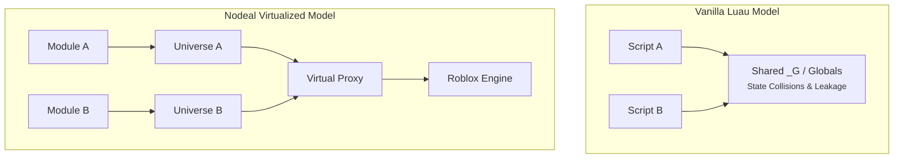
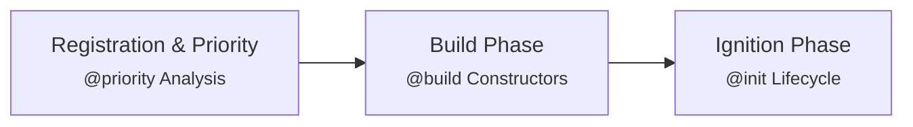

Nodeal sits directly between your Luau code and the Roblox engine. It is not merely a library of helper functions; it **virtualizes the runtime execution environment** of your scripts.

This document details the core architectural pillars that power Nodeal: sandbox virtualization, dynamic module resolution, unified dependency injection, deterministic lifecycles, and passive security.

---

## Environment Virtualization

In standard Roblox development, all scripts in a context share a common global environment. While `_G` and `shared` exist, using them often leads to security vulnerabilities, namespace collisions, and unmaintainable global state leakage.

Nodeal wraps every registered module in an isolated, sandboxed virtual environment (`universe`):



### Key Virtualization Benefits
* **Complete Scope Isolation**: Undeclared or global variables remain strictly isolated to the defining module, preventing accidental leakage into other systems.
* **API Redefinition**: Nodeal injects custom overrides for native globals (such as `typeof`, `unpack`, `require`, `print`, `warn`, `error`, and `assert`) directly into your code, keeping syntax familiar while expanding language features.
* **Virtualized `script` Identifier**: Inside every module, the global `script` variable is a virtualized [`Node`](../references/node) instance instead of a raw Roblox `ModuleScript`, providing built-in reflection and metadata queries.

---

## Module Discovery

Traditional Roblox game architecture relies heavily on physical folder structures. Moving a file often causes numerous scripts to break:

<CodeCompare>
  <CodeBlock label="Traditional Roblox (Fragile)">
    ```luau
    -- Breaks if any folder in the path is moved or renamed:
    local DataStore = require(game.ServerScriptService.Source.Core.Data.DataStore)
    ```
  </CodeBlock>
  <CodeBlock label="Nodeal Architecture (Resilient)" variant="accent">
    ```luau
    -- Location-agnostic: resolves instantly regardless of physical placement:
    local DataStore = game:GetModule("DataStore")
    ```
  </CodeBlock>
</CodeCompare>

### The Resolution Pipeline
1. **Dynamic Cataloging**: At startup, the runtime scans all tagged roots and registers every module into an internal lookup table (`name_registry`).
2. **Circular Dependency Handling**: When Module A requires Module B and Module B requires Module A, Nodeal utilizes a dynamic two-phase bootstrapping sequence to resolve both instances without deadlocking.
3. **Singleton Caching**: Once loaded, a module's exported content is permanently cached in memory. Subsequent lookups via `game:GetModule("Name")` or `require("Name")` resolve at O(1) complexity.

---

## Dependency Injection

Nodeal allows you to bind your custom singletons directly to the `game` object. Custom systems are consumed using the exact same familiar syntax used for Roblox engine services:

```luau
local __=_G() local GameController = {}

-- 1. Native Roblox service
local Players = game:GetService("Players")

-- 2. Custom Nodeal service
local InventoryService = game:GetService("InventoryService")

return __(GameController)
```

When `game:GetService("ServiceName")` is called:
1. Nodeal searches the **Custom Service Registry** first. If a matching custom service exists, it is returned immediately.
2. If no custom service matches, it falls back to Roblox's native C++ engine to resolve engine services (like `TweenService`, `RunService`, or `HttpService`).
3. If a service is required before its initialization completes, Nodeal returns a lazy proxy table that safely completes resolution once registered.

---

## Deterministic Lifecycle

One of the greatest challenges in game development is coordinating initialization orders across multiple systems. Nodeal eliminates race conditions using a deterministic two-phase lifecycle:



### The Build Phase
When a module is required during startup, its constructor routines execute immediately. By default, any function named `Build` or annotated with `@build` runs synchronously during this step:
```luau
--[=[
    @build
]=]
function DataManager.Build(): ()
    -- Establish internal data structures, register events
end
```

### The Ignition Phase
Once **all** modules across the project have completed their Build phase and registered their services, the runtime triggers the Ignition phase. Any function named `Init` or annotated with `@init` executes:
```luau
function MatchService.Init(): ()
    -- Safe to call any other service: all singletons are guaranteed ready!
    local DataService = game:GetService("DataService")
end
```

---

## Security Model

Nodeal is engineered from the ground up with a zero-trust client security model designed to resist decompilation, memory inspection, and runtime tampering.

### Passive Memory Shielding
When a module completes its handshake `return __(module)`, the closure returns `nil` to Roblox's native engine `require` pipeline. Exploits that attempt to inspect client memory by requiring `ModuleScript` instances receive `nil`, preventing unauthorized access to internal tables.

### Client Reference Cleaning
In production builds, the client runtime cleans script references from the DataModel once loaded:
* Physical script instances are detached and destroyed from the hierarchy.
* Scripts run purely in memory inside isolated Luau closures.
* Hierarchy scanners cannot locate or dump module sources.

### Active Tampering Detection
The runtime monitors client-server synchronization states. If unauthorized modifications or spoofed calls are detected:
* In Studio, it reports a clear diagnostic warning to help catch configuration mistakes.
* In live games, it invalidates network communication from the suspect client.
* When `PrivateError` is enabled in the Manifest, suspect threads are yielded rather than leaking debug stack traces.

---

## Studio Pre-Parser

All of Nodeal's advanced metadata features—including comment-based decorators, static call graph tracking, and autocomplete type injection—are powered by the **Pre-Parser**.

The Pre-Parser is a background compilation service running inside the Roblox Studio Plugin:
* **AST Analysis**: Parses Luau comment blocks (`--[=[ ... ]=]`) for `@tags`, extracting parameters, types, and semantic nesting.
* **Attribute Serialization**: Compiles parsed metadata into `ContentHeader` and `ContentPayload` attributes on the physical `ModuleScript`.
* **Static Call Tracking (`.calls`)**: Monitors call sites project-wide to power usage detection and dead-code elimination.
* **Collector Engine (`.collected`)**: Powers the `@collect` decorator pipeline, aggregating decorated methods across modules into unified dispatch tables.
