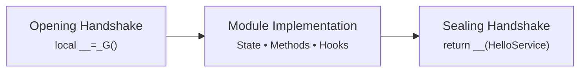

This guide walks you through installing the **Nodeal Studio Plugin**, bootstrapping your Roblox project with the automated setup wizard, and authoring your very first sandboxed module.

> [!CAUTION]
> **Early Access / Beta** — Nodeal is currently in active distribution. You can obtain the official Roblox Studio Plugin file (`.rbxm`) from our **[Discord Community](https://discord.gg/hTqXPRduHp)** or directly through our website at **[nodeal.dev](https://www.nodeal.dev)**.

---

## Quick Setup

<Steps>
  <Step title="Install the Studio Plugin">
    The Nodeal ecosystem is powered by a specialized **Roblox Studio Plugin**. This plugin drives the real-time Pre-Parser, dynamic IntelliSense engine, and workspace manager.

    1. Download the latest `Nodeal.rbxm` file from the official channel on **[Discord](https://discord.gg/hTqXPRduHp)**.
    2. Open **Roblox Studio** with any place file.
    3. Drag and drop the downloaded `.rbxm` file directly into the Studio viewport, or place it into your local Roblox Studio `Plugins` folder (`%localappdata%\Roblox\InstalledPlugins`).
  </Step>

  <Step title="Initialize the Framework Structure">
    Once the plugin is installed, configure your place to support the Nodeal runtime:

    1. In the Roblox Studio top ribbon bar, switch to the **Nodeal** tab.
    2. Click the **Setup** action button.
    3. The plugin will automatically construct the required directory structures in `ReplicatedStorage` and `ServerStorage`, tag runtime root folders with `TagRoot` collection tags, and inject the client/server entry point scripts.

    > [!TIP]
    > **Studio Workspace Recommendation**  
    > For the smoothest autocompletion and type checking experience in Studio, ensure **`UseNewLuauTypeSolver`** is disabled in your `Workspace` properties window.
  </Step>

  <Step title="Create Your First Module">
    All game logic in Nodeal resides within virtualized modules:

    1. Click the **Explorer** icon in the Nodeal ribbon to toggle the **Custom Explorer** widget.
    2. Right-click on the `Source` folder under `ReplicatedStorage` (or press <kbd>Ctrl</kbd> + <kbd>Shift</kbd> + <kbd>M</kbd>).
    3. Select **New Service** or **New Module** and name it `HelloService`.
    4. The plugin will instantiate the physical `ModuleScript` and automatically populate the virtualization boilerplate.
  </Step>
</Steps>

---

## Anatomy of a Nodeal Module

Every Nodeal script starts with the security hook and finishes with the registration handshake:

```luau
-- 1. Initialize the security accessor and define the module table
local __=_G() local HelloService = {}

-- 2. Implement your business logic
function HelloService:Greet(playerName: string): ()
    print(`Hello, {playerName}! Nodeal is running successfully.`)
end

-- 3. Lifecycle hook: Runs automatically when all modules are ready
function HelloService.Init(): ()
    HelloService:Greet("World")
end

-- 4. Complete the handshake and return nil to native require
return __(HelloService)
```

---

## Virtualization Handshake

Why does Nodeal require the `local __=_G()` and `return __(module)` syntax instead of a vanilla `return module`?



1. **`local __=_G()`**:
   Connects the module to Nodeal's runtime sandbox. This provides the script with sandboxed globals (like `typeof`, `unpack`, and custom extensions) and makes it part of the Nodeal ecosystem.
2. **`return __(HelloService)`**:
   Registers the module's table, processes any decorator annotations (such as `@build` and `@init`), and integrates the module into the service registry. Returning `__(...)` safely seals the module inside Nodeal.

> [!WARNING]
> **Strict Handshake Enforcement**  
> Never remove or bypass the `__(module)` handshake wrapper. Returning the raw table directly (e.g. `return HelloService`) bypasses the sandbox, causing the Pre-Parser to report a compilation alert and blocking the module from executing.

---

## Testing Your Experience

Press **Play** (<kbd>F5</kbd>) in Roblox Studio to test your first module:

1. Open the Roblox **Output** window (<kbd>View</kbd> &rarr; <kbd>Output</kbd>).
2. You will observe your greeting message displayed with automatic source call tracing:
   ```text
   ReplicatedStorage.Source.HelloService:6: Hello, World! Nodeal is running successfully.
   ```
3. Notice how the log contains the exact script path and line number, making debugging effortless without cluttering production builds.

---

## Next Steps

Now that your first module is up and running, explore the core concepts and advanced features:

* **[Core Concepts](./core-concepts)** — Learn how the virtualization layer isolates scripts, resolves circular dependencies, and eliminates hardcoded paths.
* **[Studio Integration](./studio-integration)** — Discover the custom explorer, real-time type inference, and package management.
* **[Services Guide](./services)** — Build singleton services that integrate with `game:GetService()`.
* **[Decorators Guide](./decorators)** — Use block comment annotations to configure lifecycle hooks and access permissions.
