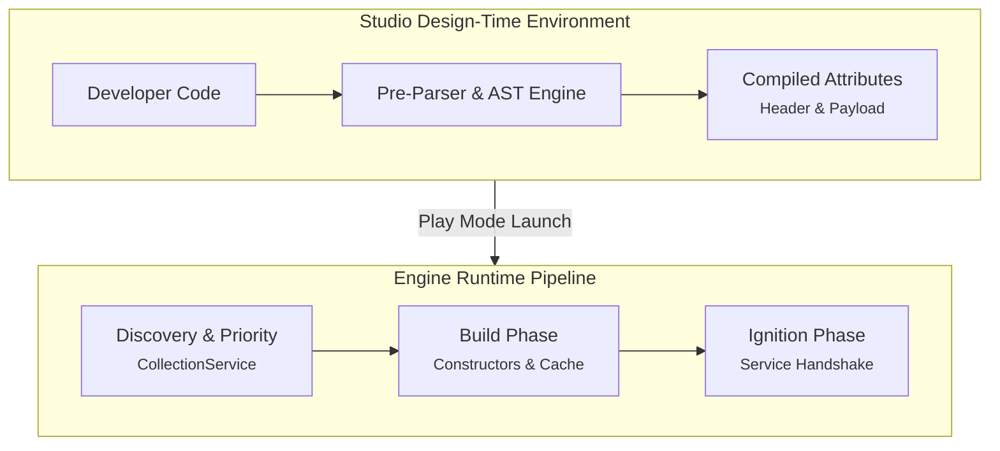

**Nodeal** is a high-performance, modular, and virtualized runtime framework designed for professional Roblox game development. It establishes a secure abstraction layer between your game logic and the Roblox engine, unlocking modern software engineering paradigms—such as sandboxed global environments, location-agnostic dependency injection, and compile-time decorators—that are fundamentally impossible in vanilla Luau.

> [!IMPORTANT]
> **100% Studio-First Workflow**  
> Nodeal is built from the ground up for Roblox Studio. You do not need external code editors, file-system synchronization daemons (like Rojo), or complex toolchains to build enterprise-grade, maintainable games on Roblox.

---

## The Nodeal Advantage

Building large-scale experiences in traditional Roblox Studio often leads to tightly coupled code, fragile hardcoded paths, and global state pollution. Nodeal solves these pain points through five core architectural pillars:

| Roblox Studio Plugin | Runtime Engine |
| :--- | :--- |
| • AST Pre-Parser & real-time validator • Dynamic type inference & docblock tooltips • Custom Explorer & script templates • Integrated Studio package manager | • Environment virtualization (`_G()`) • Deterministic two-phase lifecycle (`Build` / `Init`) • Unified service discovery (`game:GetService`) • Passive client memory shielding |

### Passive Security
Nodeal naturally hardens your game against reverse engineering and memory scraping. Module scripts are executed in isolated environments and stripped of physical references (`Instance:Destroy()`, `Name = ""`) on the client upon initialization. Client-only modules never replicate, and native `require()` returns `nil` to block external memory injection.

### Deterministic Architecture
Execution order is 100% predictable. Nodeal resolves your project's dependency graph at startup, sorting modules by priority and handling circular references cleanly before triggering synchronized **Build** and **Init** phases.

### Native Comment-Based Decorators
Supercharge your functions and classes without boilerplate code. Using standard Luau block comments (`--[=[ @tag ... ]=]`), you can declare execution contexts (`@client`, `@server`), schedule lifecycle hooks (`@build`, `@init`), configure IDE autocompletion (`@extend`, `@see`), or extract project-wide call metadata (`@collect`).

### Location-Agnostic Resolution
Never write `require(game.ServerScriptService.Modules.Path.To.Module)` again. Nodeal allows you to import modules anywhere using registered names (`game:GetModule("ModuleName")`). You can reorganize files, rename folders, and restructure your workspace without breaking a single line of code.

### Unified Service Discovery
Custom game singletons and native Roblox engine services coexist under the exact same API: `game:GetService()`. You can inject custom services, mock engine services for testing, or safely wrap native services (like `TweenService`) with custom helper methods.

---

## Architecture Comparison

| Feature | Standard Roblox Luau | Rojo / External Toolchains | Nodeal Framework |
| :--- | :--- | :--- | :--- |
| **Development Environment** | Roblox Studio | VS Code / External Files | **Roblox Studio Native** |
| **Dependency Resolution** | Hardcoded physical paths (`require(...)`) | Filesystem paths / Wally | **Location-Agnostic (`game:GetModule`)** |
| **Service Discovery** | Native engine services only | Manual singletons / Knit / Flamework | **Unified `game:GetService` Override** |
| **Global State** | Shared `_G` / `shared` (un-sandboxed) | Standard Luau global scope | **Sandboxed Virtual Environments** |
| **Function Decorators** | Not supported | TypeScript compiler transforms | **Native Luau Block Comment Annotations** |
| **Client Protection** | Exposed to local script inspection | Manual bytecode encryption / guards | **Passive RAM Shielding & Reference Nulling** |
| **Package Management** | Manual `.rbxm` drag-and-drop | CLI tools (`wally install`, `aftman`) | **In-Studio GUI Package Manager** |

---

## How It Works

Nodeal operates through seamless synergy between the design-time **Studio Plugin** and the high-performance **Runtime Engine**:

1. **Design-Time Pre-Parsing**: As you write code in Roblox Studio, the background Pre-Parser parses your scripts for block-comment decorators, module names, and call references, compiling them into instance attributes (`ContentHeader` and `ContentPayload`).
2. **Bootstrapping**: When your experience starts, the Nodeal bootstrapper discovers all tagged root containers (`CollectionService:GetTagged(TagRoot)`), resolves execution priorities, and builds the dependency graph.
3. **Virtualization**: The Runtime wraps each module in a sandboxed proxy environment. Standard global functions (`typeof`, `unpack`, `require`, `print`) are upgraded, and the Roblox `game` proxy intercepts service requests.
4. **Deterministic Execution**: The runtime loads modules sequentially, executes immediate constructor hooks (`Build`), and then fires global ignition routines (`Init`) once all dependencies are guaranteed to be initialized.

---

## Feature Roadmap

Nodeal is actively maintained and battle-tested for enterprise production environments:

* [x] **Virtual Execution Environment** — Production ready. Sandboxed per-module globals and zero state leakage.
* [x] **Unified Service & Built-in Registry** — Production ready. Seamless engine service overriding and lazy resolution.
* [x] **Dynamic Module Discovery** — Production ready. Fast O(1) location-agnostic module resolution.
* [x] **Pre-Parser Decorator Engine** — Production ready. 17 built-in decorators and extensible custom decorator API.
* [x] **Static Call Tracking & Collectors** — Production ready. Compile-time aggregation with `@collect` and `@export`.
* [x] **Two-Phase Deterministic Lifecycle** — Production ready. Unified `Build` and `Init` lifecycle targets.
* [x] **In-Studio Package Manager** — Production ready. Version-controlled package installation and dependency management.

---

### Ready to Build?
Continue to the **[Getting Started](./getting-started)** guide to install the plugin and create your first Nodeal project in seconds.
