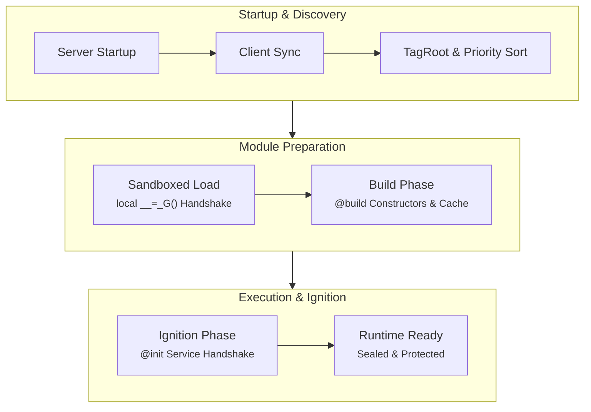

A primary challenge in large-scale Roblox game development is **execution order nondeterminism**—scripts running in arbitrary orders, race conditions when services depend on one another, and circular dependency deadlocks.

Nodeal solves this with a **predictable, two-phase lifecycle pipeline**. This guide explains how your modules and services are discovered, ordered, built, and ignited.

---

## High-Level Lifecycle



---

## Bootstrapping & Client Synchronization

When your experience launches:

1. **Server Initialization**: The server runtime starts first, immediately discovering and preparing server-side services.
2. **Client Synchronization**: When a player connects, the client runtime pauses execution until the server signals that it has completed its initialization.

This automatic synchronization ensures that:
* Network remotes created on the server during startup exist before client controllers try to connect to them.
* Replicated initial game state is fully populated before client UI and gameplay systems begin running.

---

## Root Discovery & Tree Building

Nodeal discovers your framework code using Roblox's `CollectionService`:

1. The runtime scans all containers tagged with the root tag (`TagRoot`, defaulting to `"NodealRoot"`).
2. Containers and folders are inspected for context settings:
   * **Server Containers**: Loaded exclusively on the server (e.g. `ServerStorage.Source`).
   * **Client Containers**: Loaded exclusively on the client (e.g. `StarterPlayerScripts.Source`).
   * **Shared Containers**: Loaded in both execution contexts (e.g. `ReplicatedStorage.Source`).
3. Each module is evaluated according to context decorators (`@server`, `@client`) to ensure it only loads where intended.

---

## Priority & Dependency Ordering

To prevent race conditions, Nodeal determines the exact order in which modules will load:

1. **Header Decorators**: If a module specifies `@priority <number>` in its docblock, that priority takes precedence.
2. **Container Priority**: Root containers can specify default priorities via folder attributes.
3. **Automated Dependency Graph**: For modules without an explicit priority, the Studio plugin automatically analyzes static dependencies (such as `game:GetService()` and `game:GetModule()`), placing provider modules before consumer modules.

### Circular Dependency Protection
If two modules reference each other cyclically, the Studio plugin detects the loop during pre-parsing, logs a warning in your Studio Output, and applies a safe fallback order so your game can continue running without hanging.

---

## Module Loading & Handshake

During this phase, Nodeal requires each module in its resolved priority order:

1. The module executes its opening handshake:
   ```luau
   local __=_G()
   ```
   This gives the module its sandboxed environment and access to Nodeal's global utilities.
2. The module defines its internal state and public methods.
3. The module finishes with its closing handshake:
   ```luau
   return __(MyService)
   ```
   This registers the module's exported table, compiles any decorator annotations (like `@build` and `@init`), and safely integrates it into the service registry.

---

## The Build Phase

As each module loads, its constructor routines run immediately:

```luau
local __=_G() local PlayerService = {}

-- Methods named 'Build' run automatically during module load
function PlayerService.Build(): ()
    PlayerService.Cache = {}
    print("PlayerService: internal state initialized.")
end

-- You can also mark any custom method with @build:
--[=[
    @build
]=]
function PlayerService.SetupEvents(): ()
    -- Immediate setup...
end

return __(PlayerService)
```

### What belongs in the Build phase?
* Creating internal tables, default values, and caches.
* Initializing non-dependent helper objects or proxy wrappers.
* Setting up signals or event listeners that do not require other custom services.
* ⚠️ **Do not call methods on other custom services during Build**, as they may still be loading.

---

## The Ignition Phase

Once **every module in your game** has loaded and finished its Build phase, Nodeal triggers the **Ignition Phase**. This is where your systems wake up and start interacting:

```luau
local __=_G() local MatchmakingService = {}

-- Methods named 'Init' run automatically during Ignition
function MatchmakingService.Init(): ()
    -- SAFE: All custom services are guaranteed to be built and registered!
    local PlayerService = game:GetService("PlayerService")
    local InventoryService = game:GetService("InventoryService")

    print("MatchmakingService started successfully.")
end

-- You can also mark any custom method with @init:
--[=[
    @init
]=]
function MatchmakingService.StartMatchLoop(): ()
    task.spawn(function()
        -- Background game loop...
    end)
end

return __(MatchmakingService)
```

### What belongs in the Init phase?
* Calling methods on other custom services and controllers.
* Starting asynchronous game loops (`task.spawn`, `RunService.Heartbeat:Connect`).
* Reading initial data from data stores or external services.

### Disabling Automatic Hooks
If you have an object or utility class with a method named `Init` or `Build` that you only want to call manually, you can disable automatic execution using `@init false` or `@build false`:

```luau
--[=[
    @init false
]=]
function CharacterItem:Init(): ()
    -- This will NOT run automatically during framework ignition!
end
```

---

## Finalization

Once the Ignition phase completes:

1. Nodeal marks the runtime as fully loaded.
2. Any pending service requests or queries resolve instantly.
3. On the client, initialization scripts are cleanly disposed of from memory to protect your game logic and reduce memory overhead.
