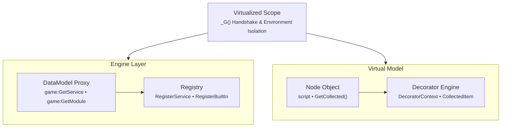

The **Nodeal API Reference** provides exhaustive technical specifications for the entire framework runtime and compiler surface. It documents custom global functions, proxies and extensions injected into Roblox's `DataModel` (`game`), the virtual `Node` object model, lifecycle execution contexts, and metadata structures.

> [!TIP]
> Use the sidebar navigation to jump directly to specific API categories. Every entry is structured following the **Roblox Creator Documentation** standard, featuring exact signatures, parameter types, return values, context scoping tags, and production-tested Luau code samples.

---

## Architecture Overview

Nodeal establishes a sandboxed virtualization layer between your Luau code and the Roblox engine. This architecture is exposed through three interconnected layers:



---

## Quick Navigation

### Technical API References
| Reference Page | Category | Primary Purpose | Scope |
| :--- | :--- | :--- | :--- |
| **[Globals](./globals)** | Core Globals | Sandboxed Luau globals (`typeof`, `unpack`, `require`, `newproxy`, `print`, `warn`, `error`, `assert`, `debug`, `_G`, `script`). | [Shared] |
| **[Game](./game)** | Engine Extensions | Methods injected into the Roblox `game` proxy (`GetModule`, `GetService`, `RegisterService`, `RegisterBuiltIn`, `RegisterDecorator`, `GetNative`). | [Shared] |
| **[Node](./node)** | Object Model | The virtualized instance wrapper returned by `script`, `game:GetModule()`, and root traversal. | [Shared] |
| **[Decorators](./decorators)** | Annotations | Complete reference of all 17 built-in comment decorators, signatures, and autocomplete behaviors. | [Shared] |
| **[DecoratorContext](./decorator-context)** | Metaprogramming | Context object supplied to custom decorator callbacks registered via `game:RegisterDecorator()`. | [Shared] |
| **[CollectedItem](./collected-item)** | Metaprogramming | Metatable-driven record representing decorated functions captured via the `@collect` pipeline. | [Shared] |

### Architectural Guides
| Guide | Category | Primary Purpose |
| :--- | :--- | :--- |
| **[Lifecycle](../guides/lifecycle)** | Architecture | Complete execution sequence, topological Kahn sorting, cycle detection, Build vs Init phases. |
| **[Security](../guides/security)** | Architecture | Passive memory shielding, client instance cleaning, active tamper detection, and production privacy. |
| **[Decorators](../guides/decorators)** | Modules | Complete reference of all 17 built-in comment-based decorators (`@client`, `@server`, `@build`, `@init`, `@extend`, `@export`, etc.). |
| **[Built-ins](../guides/builtins)** | Modules | Framework-wide utilities and standard library extensions injected into the global namespace. |
| **[Packages](../guides/packages)** | Packages | In-Studio package manager, browsing community packages, and publishing to `nodeal.dev/packages`. |
| **[Configuration](../guides/configuration)** | Architecture | Configuration attributes on `Manifest`, root container tags, and environment variables. |

---

## Global Functions

Nodeal replaces and extends standard Luau globals inside virtualized modules:

| Function | Signature | Return Type | Description |
| :--- | :--- | :--- | :--- |
| **`require`** | `(module: string \| Node \| ModuleScript)` | `any?` | Resolves Nodeal `Node` instances, registered module names, or native Roblox `ModuleScript`s. |
| **`newproxy`** | `(object?: any, force?: boolean)` | `Proxy \| userdata` | Wraps native Roblox Instances, tables, or userdatas in a secure, metatable-driven proxy wrapper. |
| **`typeof`** | `(value: any, ...acceptedTypes: string \| {string})` | `string?` | Multi-type resolution respecting custom `__type` strings or functions. |
| **`unpack`** | `(target: table \| Userdata \| Node, start?: number, finish?: number)` | `...any` | Enhanced unpack that respects the custom `__unpack` metamethod on virtual objects. |
| **`setmetatable`** | `(tbl: table, mt: table)` | `table` | Delegates to the table's `__setmetatable` method if defined. |
| **`getmetatable`** | `(tbl: table)` | `table?` | Respects custom `__getmetatable` closures to secure internal metatables. |
| **`print`** | `(...any)` | `void` | Prepends source script and line traces (`[script:line]`); respects `PrivatePrint` in production. |
| **`warn`** | `(...any)` | `void` | Warning logger with source traces; respects `PrivateWarn` in production. |
| **`error`** | `(message?: string, level?: number)` | `void` | Verbose runtime error; raises a bare error in production when `PrivateError` is active. |
| **`assert`** | `(value: T?, message?: string, level?: number)` | `T` | Assertion handler routing failures through the Nodeal runtime error boundary. |
| **`debug`** | `debug` | `table` | Copy of the debug library exposing framework-wrapped logging primitives. |
| **`_G`** | `() -> (content: any?) -> nil` | `function` | The framework handshake accessor captured at the top of every module. |

---

## Engine Extensions

The virtualized `game` global intercepts DataModel calls and introduces location-agnostic dependency injection:

| Method | Signature | Return Type | Description |
| :--- | :--- | :--- | :--- |
| **`game:GetModule`** | `(moduleName: string)` | `Node \| any` | Resolves a module script by name, abstracting physical folder hierarchies. Returns a lazy proxy if pending. |
| **`game:HasModule`** | `(moduleName: string, loaded?: boolean)` | `boolean` | Verifies whether a module is registered in the name registry, and optionally if it has been loaded. |
| **`game:GetService`** | `(serviceName: string)` | `any` | Drop-in override for `game:GetService`. Checks custom service singletons first before native engine services. |
| **`game:HasService`** | `(serviceName: string)` | `boolean` | Checks if a service is registered in the custom service registry or native engine. |
| **`game:RegisterService`**| `(serviceName: string, instance?: table \| Userdata)` | `void` | Registers a singleton service accessible project-wide via `game:GetService()`. |
| **`game:RegisterModule`** | `(moduleName: string, instance?: table \| Userdata)` | `void` | Dynamically registers or updates a module in the runtime name lookup registry as a `Node`. |
| **`game:RegisterBuiltIn`**| `(builtInName: string, library: table \| Userdata)` | `void` | Injects a stateless utility library directly into the global namespace of all modules. |
| **`game:RegisterDecorator`**| `(tag: string, wrapper: function)` | `void` | Registers a custom comment-based decorator wrapper. |
| **`game:GetNative`** | `(name: string)` | `any?` | Directly retrieves native Luau/Roblox environment symbols before virtualization. |

---

## Virtual Classes

| Class | Primary Purpose | Key Methods / Properties |
| :--- | :--- | :--- |
| **[`Node`](./node)** | The virtualized instance wrapper representing scripts and instances in the hierarchy. | `Instance`, `Children`, `Parent`, `Name`, `FullName`, `Attributes`, `Content`, `Clone()`, `GetCollected()`, `GetCalls()`, `Destroy()` |
| **[`DecoratorContext`](./decorator-context)** | Context state provided to decorator wrappers registered with `game:RegisterDecorator()`. | `Name`, `Arguments`, `Parent`, `Children`, `Instance`, `Method`, `OriginalFunction`, `WrappedFunction`, `GetChildren()`, `FindFirstChild()` |
| **[`CollectedItem`](./collected-item)** | Record returned by `Node:GetCollected()`, holding metadata and call tracking for decorated methods. | `modules`, `services`, `method`, `access`, `exports`, `args`, `Resolve()`, `GetUsage()` |

---

## Built-in Decorators

Declared in Luau block comments (`--[=[ ... ]=]`) directly above methods or modules. Full documentation in the **[Decorators Reference](./decorators)**:

| Category | Decorators | Key Purpose |
| :--- | :--- | :--- |
| **Context & Scoping** | `@server`, `@client`, `@context`, `@hidden` | Control server/client execution rules and autocomplete visibility. |
| **Lifecycle & Priority** | `@build`, `@init`, `@priority` | Schedule constructor (`Build`) and ignition (`Init`) execution hooks. |
| **IntelliSense & Tooltips** | `@param`, `@return`, `@see`, `@example`, `@alias`, `@deprecated`, `@overloads` | Power rich Studio hover tooltips, strikethrough warnings, and code samples. |
| **Metaprogramming** | `@collect`, `@export`, `@extend` | Aggregate method collections into `.collected` and expand caller completions. |

---

## Virtualization Handshake

To guarantee sandbox isolation, static analysis, and runtime protection, every Nodeal module script **must** begin and end with this standardized handshake:

```luau
-- 1. Initialize the security accessor
local __=_G()

-- 2. Define the module table or OOP class
local CombatService = {}

function CombatService:Attack(targetPlayer: Player, damageAmount: number): ()
    print(`Attacking {targetPlayer.Name} for {damageAmount} damage.`)
end

-- 3. Return the module via the security handshake
return __(CombatService)
```

### The Three Phases of the Handshake
1. **Scope Capture (`local __=_G()`)**:
   Connects the module to the Nodeal runtime sandbox, injecting virtualized globals and verifying the module origin.
2. **Decorator & Lifecycle Compilation (`__(CombatService)`)**:
   Registers the module table, resolves method-level decorators (`@build`, `@init`, `@client`, `@server`, etc.), binds lifecycle hooks, and caches the module in the registry.
3. **Memory Shielding (`return nil`)**:
   Returns `nil` to Roblox's native C++ `require` engine so external scripts and exploiters cannot extract the module table by calling `require()` on the physical instance.
